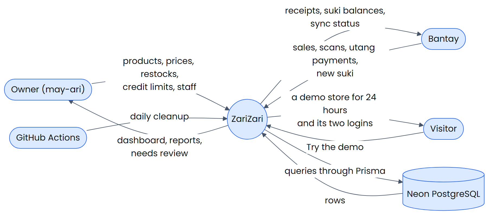
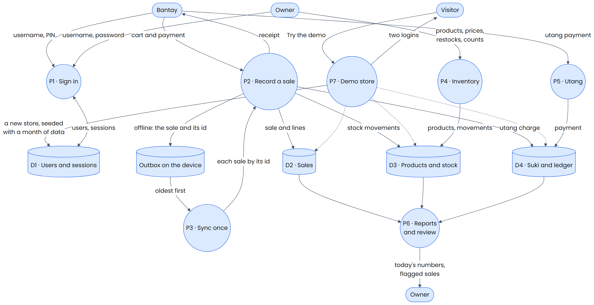
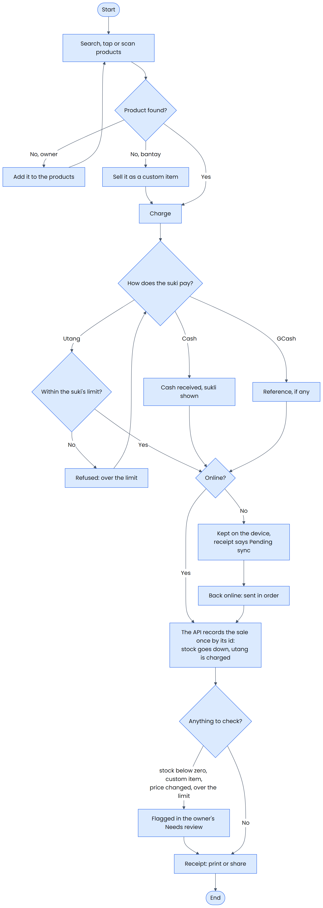

# ZariZari

**Point of sale, inventory and utang ledger for the sari-sari store**

ZariZari is a web app for a small Philippine neighborhood store. The bantay sells from a phone or a laptop by search, tap or barcode, gives the right sukli and keeps selling when the internet drops. The may-ari (owner) manages products, prices, stock, credit limits and staff, and sees the day's numbers. Every visitor can open a demo store of their own, with a month of history, in one click.

[](https://github.com/jomari18/sarisari-pos/actions/workflows/ci.yml)

## Live Demo

**[Open ZariZari](https://zarizari.netlify.app)** and press **Try the demo**. The demo store is yours for 24 hours: no sign-up. The free server sleeps when nobody uses it, so the first visit can take up to a minute to wake it.

## Highlights

- **Point of sale:** search, category tiles and barcode scanning (the browser's own `BarcodeDetector`, with ZXing where there is none). Cash with quick amounts and the sukli, GCash with its reference, or utang within the suki's credit limit. Receipts print on a 58 mm printer or share as an image.
- **Works offline.** The app installs as a PWA. Without a connection the bantay keeps selling from the catalog saved on the device; each sale is queued with its own id and sent once, in order, when the connection returns. A sale the store refuses shows under "Couldn't sync".
- **Utang ledger:** a credit limit for each suki, payments applied to the oldest charges first, aging (0–7, 8–30 and 31+ days) and a polite reminder message to copy.
- **Inventory:** products and categories, restocks by boxes and pieces, stock counts that record the difference, spoilage, a low-stock list and a restock list to copy.
- **For the owner:** a dashboard, reports (payment mix, trend, best sellers, sales by hour, slow movers, utang aging), a review list of flagged sales (stock below zero, custom items, prices changed offline, utang over the limit, a phone clock that was off), sales with voids, and staff with PINs.
- **Two roles,** may-ari and bantay, enforced by the API on every route, not only hidden in the screens.
- **A 3D tindahan** on the landing page (React Three Fiber), loaded only when it will play, paused when hidden, and replaced by a still picture under reduced motion or without WebGL.
- Light and dark themes, layouts from 360 px phones to wide desktops, 44 px touch targets, and axe checks in the end-to-end tests.

## System design

| Context diagram | Data flow diagram |
|---|---|
|  |  |



```
Browser (React PWA)
  │  static files, service worker ──────────────► Netlify CDN
  │  /api/*  (same origin) ──► Netlify signed proxy ──► Render: Docker container (Express API) ──► Neon PostgreSQL
  └─ wake-up ping: GET https://zarizari-api.onrender.com/api/health (direct, CORS for the site only)
```

The full design is in [docs/superpowers/specs/2026-10-21-sarisari-pos-design.md](docs/superpowers/specs/2026-10-21-sarisari-pos-design.md).

## Tech Stack

- React 19, TypeScript (strict), Vite, Tailwind CSS v4, React Router, TanStack Query
- Express 5 REST API, Prisma 7, PostgreSQL 17 (Neon), zod schemas shared by the app and the API
- JWT access tokens (jose) with rotating refresh sessions, argon2id
- Dexie (IndexedDB) and Workbox (vite-plugin-pwa) for offline selling
- React Three Fiber (three.js), ZXing
- Vitest, Testing Library, Supertest, Playwright, axe
- Docker, GitHub Actions, Netlify, Render

## Security Design

- **Only the website can call the API.** Netlify signs every proxied request with a JWS in `x-nf-sign`; the API refuses every route except `/api/health` without a valid signature, so nobody can call Render directly or fake the visitor's IP.
- **Sessions:** a 15-minute access token kept in memory only, and a refresh token in an `httpOnly`, `Secure`, `SameSite=Strict` cookie that rotates on every use. Passwords and PINs are hashed with argon2id; five wrong tries lock an account for 15 minutes.
- **Roles and stores are checked on the server.** Every owner route refuses a bantay, and every query filters by the store in the access token; another store's ids answer 404.
- **Sales are idempotent.** The device names each sale; sending it twice returns the stored sale and changes nothing, so a retry or a sync never records a sale twice.
- **Visitors' IPs are kept only as salted hashes,** for the five-demo-stores-a-day limit.
- **Security headers:** a strict Content Security Policy (scripts from the site only, no `eval`), `frame-ancestors 'none'`, `Permissions-Policy: camera=(self)`, HSTS, `nosniff` and a strict referrer policy; helmet on the API.

> Secrets (the JWT secret, the proxy signing secret, the cleanup secret, the IP salt and the database URLs) live only in Render, Netlify and GitHub settings. They are never committed to this repository.

## Database

The Prisma schema and migrations are in [`apps/api/prisma`](apps/api/prisma). Every table except the demo quota belongs to a store:

- `Store`, `User` (may-ari and bantay) and `Session` (refresh sessions)
- `Category`, `Product` and `StockMovement` (every sale, restock, count, spoilage and void)
- `Sale` and `SaleItem`, with the receipt number, the payment and the review flags
- `Customer` (suki) and `UtangEntry` (charges, payments, adjustments and voids)
- `DemoQuota`: demo stores opened per hashed IP per day

A daily GitHub Actions job deletes demo stores older than 24 hours at 3:00 AM Philippine time.

## Local Use

Requires Node.js 24 and Docker.

```bash
npm ci
docker compose up -d
npm run dev -w @sari/web
```

Docker Compose starts PostgreSQL 17 on `127.0.0.1:55433` and the API's Docker image on `127.0.0.1:8080`; the API migrates its database when it starts. Vite serves the app on <http://localhost:5173> and signs `/api` requests the way Netlify will. Open it and press **Try the demo**. Every value in `docker-compose.yml` is for local use only.

## Testing

```bash
npm run lint
npm run typecheck
npm test
npm run test:api
npm run build -w @sari/web
npm run test:e2e
```

- `npm test`: unit and component tests for the shared package and the web app (Vitest, Testing Library).
- `npm run test:api`: every endpoint for both roles and anonymous callers, store isolation, duplicate sale ids and all-or-nothing sales, against the local PostgreSQL in Docker (Vitest, Supertest).
- `npm run test:e2e`: Playwright against the production build and the API's Docker image: a demo sale, utang and a payment, the bantay's limits, a scanned barcode, an offline sale that syncs once, a 360 px phone, and axe in both themes.

CI runs all of them on every push, the end-to-end tests on the same Docker image that Render runs.

## Deployment

- **Netlify** builds the web app and proxies `/api` to Render ([`netlify.toml`](netlify.toml)).
- **Render** runs the API's Docker image on the free plan, after CI passes ([`render.yaml`](render.yaml)).
- **Neon** hosts PostgreSQL.
- **GitHub Actions** runs CI ([`ci.yml`](.github/workflows/ci.yml)) and the daily cleanup ([`cleanup.yml`](.github/workflows/cleanup.yml)).

## Credits

UI adapted from "POS System Web UI" by Abubakar Sherazi (Figma Community), licensed under CC BY 4.0 (https://creativecommons.org/licenses/by/4.0/). Changes: blue accent, new brand, sari-sari screens and content, icons.

Icons: [Lucide](https://lucide.dev) (ISC License). Font: Poppins by Indian Type Foundry (SIL Open Font License 1.1). 3D: [three.js](https://threejs.org) and [React Three Fiber](https://github.com/pmndrs/react-three-fiber) (MIT License). Barcode scanning: [ZXing](https://github.com/zxing-js/library) (Apache License 2.0).

## Author

**Jomari M. Candido**
Sole Software Developer · [Portfolio](https://jomaricandido.netlify.app) · [GitHub](https://github.com/jomari18)

## Project Status

Portfolio project, version 1.0. Demo stores and their data are deleted after 24 hours.
